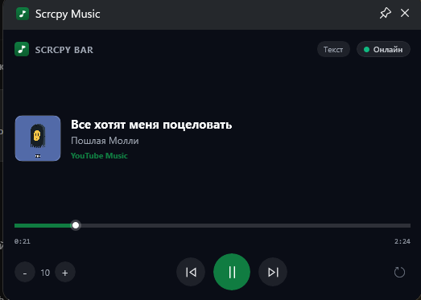
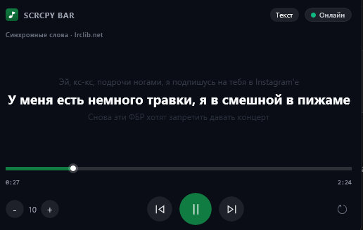

<div align="center">

# ScrcpyBar


**Музыка с телефона — прямо в оверлее Xbox Game Bar.**

</div>

---

Играешь на ПК, а музыка идёт с Android-телефона? ScrcpyBar выводит трек, обложку и
караоке-слова в виджет Xbox Game Bar (`Win + G`) поверх игры, а управление идёт прямо из
превью — перемотка мышью, пауза, громкость. Связь с телефоном **только по USB**, без
Wi-Fi и без интернета.

<div align="center">

## ⚡ Быстрый старт: один файл

### 1. Скачай `ScrcpyBar.Bridge.exe`

Из [Releases](https://github.com/bmarcnhii1-max/scrcpybar/releases/latest) — один
self-contained exe, внутри него .NET 8, виджет, companion и все зависимости.

### 2. Запусти его

Двойной клик. Появится значок в трее, окно и консоли не будет.

### 3. Окно первоначальной настройки сделает всё остальное

Само поставит виджет в Game Bar (один запрос UAC) и companion на телефон по USB.
Больше ничего настраивать не нужно.

</div>

<details>
<summary><b>Скриншот / гифка</b></summary>

<p>
  
  
</p>
<p align="center"><sub>Слева — плеер с обложкой и управлением телефоном. Справа — караоке-текст от lrclib.net с подсветкой текущей строки.</sub></p>

</details>

---

## Как это работает

```
┌──────────────────────────┐        USB / adb          ┌────────────────────────────┐
│  Android-телефон         │  ──────────────────────▶ │  ScrcpyBar.Bridge.exe      │
│  ScrcpyBar Companion      │   adb forward            │  один exe, работает в трее │
│  Notification Listener    │   tcp:39282 → tcp:38080  │  HTTP-API: 127.0.0.1:39281 │
│  MediaSessionManager      │                           └─────────────┬──────────────┘
└──────────────────────────┘                                         │ SMTC
                                                                       ▼
                                                          ┌────────────────────────────┐
                                                          │  Xbox Game Bar widget     │
                                                          │  «Scrcpy Music» (Win + G) │
                                                          │  обложка · трек · слова   │
                                                          └────────────────────────────┘
```

| Узел | Что делает | Технологии |
|---|---|---|
| **ScrcpyBar Companion** | Читает активную `MediaSession`, отдаёт метаданные, обложку и принимает команды. Требует только «Доступ к уведомлениям» — без root и без accessibility. | Kotlin, `NotificationListenerService` |
| **ScrcpyBar.Bridge** | Опрашивает companion по USB-туннелю, кеширует обложки и слова, публикует сессию в Windows. Работает в трее, конфигурации не требует. | .NET 8, self-contained single-file |
| **ScrcpyBar Widget** | Оверлей Game Bar: обложка, название, исполнитель, караоке-слова, перемотка мышью, ⏮ ⏯ ⏭, громкость. | UWP XAML, `Microsoft.Gaming.XboxGameBar` |

Трафик физически не покидает USB-кабель: companion слушает только `127.0.0.1` на телефоне,
а наружу порт пробрасывается через `adb forward`.

<details>
<summary><b>Подробности протокола</b></summary>

* Companion биндит HTTP-API на `127.0.0.1:38080` внутри телефона.
* Bridge поднимает `adb forward tcp:39282 tcp:38080` и слушает `127.0.0.1:39281`.
* Виджет ходит в Bridge по HTTP и запрашивает loopback-exemption
  (`CheckNetIsolation LoopbackExempt`) — без него UWP-виджет не достучится до локального порта.
* Метаданные публикуются через **SMTC** (`Windows.Media.MediaPlayback`), поэтому трек
  дополнительно виден в панели «Windows Media Controls» (`Win + ↑`) и на медиаклавишах.

</details>

### Возможности

| | |
|---|---|
| **Обложка** | Тянется из `MediaSession`, кешируется на диске. |
| **Караоке-слова** | Синхронные строки с [lrclib.net](https://lrclib.net) (без API-ключа), кешируются. Текущая строка подсвечивается, спетое — белым. |
| **Переход по клику** | Клик по любой строке песни перематывает трек на нужную секунду. |
| **Перемотка мышью** | Тяни полосу прогресса прямо в виджете. |
| **Управление** | Кнопки ⏮ ⏯ ⏭, громкость, пауза — всё из превью. |
| **Один телефон** | Выбор устройства закрепляется в `device.txt` или через `SCRCPYBAR_DEVICE`. |

---

## Сборка из исходников

**Требуется:** Visual Studio 2022 (рабочая нагрузка «Разработка приложений для
универсальной платформы Windows», Windows 10/11 SDK), .NET 8 SDK, JDK 17, Android SDK,
`adb` в `PATH`.

| Компонент | Команда |
|---|---|
| Companion (APK) | `cd ScrcpyBar.Android && gradlew.bat assembleDebug` |
| Виджет (MSIX) | `powershell -ExecutionPolicy Bypass -File .\rebuild_and_deploy.ps1` |
| Bridge (EXE) | `dotnet publish ScrcpyBar.Bridge -c Release -r win-x64` |

Скрипт `rebuild_and_deploy.ps1` собирает виджет, регистрирует пакет и выдаёт
loopback-exemption. Готовые артефакты кладутся в `build/` — именно они и публикуются
в Releases.

<details>
<summary><b>Структура репозитория</b></summary>

```
ScrcpyBar.sln              решение Visual Studio 2022
ScrcpyBar.Android/         Kotlin-приложение на телефоне (com.scrcpybar.companion)
ScrcpyBar.Bridge/          фоновый сервис .NET 8 (один exe)
ScrcpyBar.Widget/          виджет Xbox Game Bar (UWP XAML)
build/                     готовые артефакты релиза
```

**Скрипты:**

| Файл | Назначение |
|---|---|
| `rebuild_and_deploy.ps1` / `.bat` | Пересборка виджета + регистрация + loopback-exemption. |
| `verify.ps1` | Сквозная проверка: companion → Bridge → HTTP-API → SMTC → виджет. Флаг `-Transport` добавляет нажатия кнопок. |
| `check_smtc_sessions.ps1` | Диагностика: все SMTC-сессии системы, метаданные, обложка. |
| `check_widget_log.ps1` | Лог событий указателя виджета. |
| `check_lyrics_flow.ps1` | Прогон сценария слов песни как в виджете. |
| `start_bridge.bat` | Запуск Bridge. |
| `open_in_vs.bat` | Открыть решение в Visual Studio 2022. |

**HTTP-API Bridge** (`127.0.0.1:39281`):

| Метод | Путь | Описание |
|---|---|---|
| `GET` | `/api/track` | Трек, позиция, длительность, обложка |
| `GET` | `/api/cover` | Обложка (JPEG/PNG) |
| `GET` | `/api/lyrics` | Слова песни (`linesText` — `timeMs<TAB>текст`) |
| `POST` | `/api/play-pause` | Пауза / воспроизведение |
| `POST` | `/api/next` · `/api/prev` | Следующий / предыдущий трек |
| `POST` | `/api/seek?seconds=±N` | Перемотка относительно (шаг ±300 с) |
| `POST` | `/api/seek-position?positionMs=&durationMs=` | Точная перемотка |
| `POST` | `/api/rewind` · `/api/fast-forward` | Короткая перемотка ±5 с |
| `POST` | `/api/vol-up` · `/api/vol-down` · `/api/volume?level=N` | Громкость |
| `GET` | `/` | Веб-пульт |

</details>

---

## Требования

* **PC:** Windows 10 19041 (20H1) или новее, .NET 8 (внутри Bridge).
* **Телефон:** Android 5.0+ с включённой отладкой по USB.
* **Кабель:** USB, на котором телефон виден в `adb devices`.
* **Виджет:** ставится сам из окна первоначальной настройки (нужен UAC).

---

## Troubleshooting

| Симптом | Причина и решение |
|---|---|
| `Мост офлайн` в виджете | Не запущен Bridge. Запусти `ScrcpyBar.Bridge.exe`, дождись значка в трее. |
| Виджет не появился в `Win + G` | Не установлен пакет. Запусти `install-widget.ps1` из релиза вручную или заново пройди первоначальную настройку. |
| Виджет не видит Bridge | Не выдан loopback-exemption. `install-widget.ps1` делает это сам (`CheckNetIsolation LoopbackExempt`). |
| `Нет телефона` | Телефон не в `adb devices`. Переподключи кабель, включи «Отладку по USB», проверь `adb devices`. |
| `Нет доступа к медиа` | Companion без разрешения на уведомления. Открой приложение на телефоне и выдай «Доступ к уведомлениям». |
| Пустое поле обложки | Плеер не отдаёт обложку через `MediaSession` — это нормально, остальные поля работают. |
| Слова не появляются | Для трека нет синхронных слов на lrclib.net. Показывается обычный текст песни. |
| **MIUI / HyperOS: companion не отвечает** | Фоновый сервис убивается системой. Разреши companion автозапуск и работа в фоне: *Настройки → Приложения → ScrcpyBar Companion → Автозапуск, без ограничений*, и отключи оптимизацию батареи для него. |
| Значок в трее не появился | Bridge падал при старте — смотри лог. Обычно занят порт `39281` или кривой .NET SDK. |
| Логи | `%LOCALAPPDATA%\ScrcpyBar\bridge.log` (ротация на 5 МБ, старый — `bridge.old.log`). Для консоли: `ScrcpyBar.Bridge.exe --console`. |

---

## Поддерживаемые плееры

Любое приложение с активной `MediaSession`. Проверено на YouTube Music; поддерживаются
Spotify, Яндекс Музыка, VK Музыка, SoundCloud, Apple Music, Deezer и системные плееры Android.

---

## Лицензия

[MIT](LICENSE) © ScrcpyBar contributors

---

<div align="center">

Built with [Claude Code](https://claude.com/claude-code)

</div>
